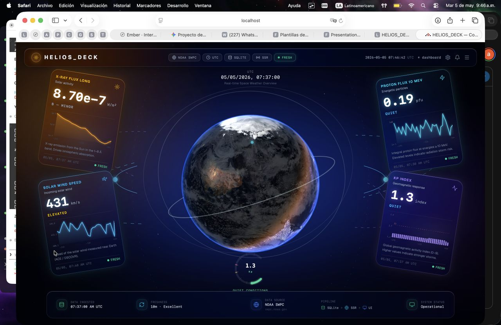

# HELIOS_DECK

**English** · [Español](README.es.md)

A full-stack web dashboard for **space weather**. It downloads live data from NOAA, stores it in
**SQLite** and renders it on the server. There is no demo data: every number on the screen is a
real measurement from a real instrument.



> **Demo:** there is no live deployment at the moment. You can run it locally in two commands
> (see [Run it locally](#run-it-locally)).

---

## What it does

HELIOS_DECK tracks four signals from NOAA's Space Weather Prediction Center (SWPC):

| Signal | Source | Unit | Update rate |
|---|---|---|---|
| Kp index (geomagnetic activity) | NOAA SWPC | index | 3 h |
| Solar wind speed | NOAA SWPC (DSCOVR) | km/s | ~1 min |
| X-ray flux, 0.1–0.8 nm (solar flare class A/B/C/M/X) | NOAA GOES | W/m² | ~1 min |
| Proton flux, ≥10 MeV (radiation storm context) | NOAA GOES | pfu | ~1 min |

There are two views:

- **`/dashboard`** — an instrument console. It follows the cause-and-effect chain:
  solar activity → solar wind → geomagnetic response.
- **`/cosmic-view`** — a full-screen 3D Earth (Three.js, custom GLSL shaders) with a live Kp overlay
  and four floating signal cards.

Each value shows how old it is. If the data is older than a set limit (Kp 3 h, solar wind 1 h,
X-ray 30 min, protons 1 h), the card is marked **STALE**.

## Architecture

The code is split into layers. Each layer has one job, and no layer imports from a layer above it.

```
NOAA SWPC API
  └─ app/services/fetchers/      HTTP request
       └─ app/services/normalizers/   raw JSON → SignalRecord (one shared data contract)
            └─ app/services/ingest/    coordinator + de-duplication
                 └─ app/services/signals.server.ts   save to SQLite
                      └─ app/routes/*.tsx   route loader reads the database (server-side)
                           └─ React components   render only, no data logic
```

- **Ingestion is a separate step.** The page loader only reads from the database; it never calls
  NOAA. Ingestion runs from scripts (`npm run ingest:all`).
- **One data contract.** Every signal is normalized into the same `SignalRecord` shape, so adding a
  new signal does not change the database or the UI components.
- **No duplicates.** Records with the same timestamp, source and signal are skipped.

More detail: [`docs/architecture.md`](docs/architecture.md) and
[`docs/data-contract.md`](docs/data-contract.md).

## Stack

| Layer | Technology |
|---|---|
| Frontend + SSR | React Router v7 |
| Language | TypeScript (strict mode) |
| Database | SQLite with `better-sqlite3` |
| Styles and UI | Tailwind CSS v4, shadcn |
| 3D view | Three.js / React Three Fiber |
| Tests | Vitest |
| Packaging | Docker |

## Run it locally

```bash
npm install
npm run ingest:all   # download the four signals from NOAA
npm run dev          # http://localhost:5173
```

Then open **http://localhost:5173/dashboard** or **http://localhost:5173/cosmic-view**.
If a card shows **STALE**, run `npm run ingest:all` again.

You can also ingest one signal at a time:

```bash
npm run ingest:noaa-kp
npm run ingest:noaa-solar-wind
npm run ingest:noaa-xray-flux
npm run ingest:noaa-proton-flux
```

`ingest:all` runs the four pipelines one after another, prints a summary table and exits with
code 1 if any signal fails.

## Tests and checks

```bash
npm run typecheck   # react-router typegen + tsc (strict)
npm run build       # production build (client + SSR)
npm test            # Vitest unit and component tests
```

GitHub Actions runs these three checks on every push and pull request. The tests use an in-memory
SQLite database, so CI needs no secrets and never calls NOAA.

> **Known issue:** the `typecheck` step in CI has been failing since May 2026. Fixing it is the
> next task.

## Design decisions

All technical decisions are recorded as ADRs in [`docs/decisions.md`](docs/decisions.md). Some of
them:

- **React Router v7 SSR instead of Next.js** (ADR-001).
- **SQLite with `better-sqlite3`**: one file, no server to run, enough for this amount of data
  (ADR-003, ADR-010).
- **The loader does not ingest data**; ingestion is a separate step (ADR-011, ADR-012).
- **A normalized signal contract** (`SignalRecord`) shared by all sources (ADR-009).

## Documentation

| File | Purpose |
|---|---|
| [`docs/plan.md`](docs/plan.md) | Project plan by phases |
| [`docs/checkpoint-1.md`](docs/checkpoint-1.md) | Phase 1 milestone: walking skeleton |
| [`docs/checkpoint-2.md`](docs/checkpoint-2.md) | Phase 2 final state: 4 signals + cosmic view |
| [`docs/architecture.md`](docs/architecture.md) | System architecture and deployment notes |
| [`docs/data-contract.md`](docs/data-contract.md) | `SignalRecord` shape and normalizer contract |
| [`docs/api-sources.md`](docs/api-sources.md) | Comparison of API sources |
| [`docs/decisions.md`](docs/decisions.md) | Technical decision log (ADRs) |
| [`docs/ai-usage.md`](docs/ai-usage.md) | AI usage policy and session log |

## How I built this

I used AI coding assistants during development. The rules I followed are in
[`docs/ai-usage.md`](docs/ai-usage.md): every important prompt is logged, every generated change is
reviewed line by line before it is committed, and architecture decisions are made and written down
by me in the ADR log. The development rules for the assistant are in [`CLAUDE.md`](CLAUDE.md).
